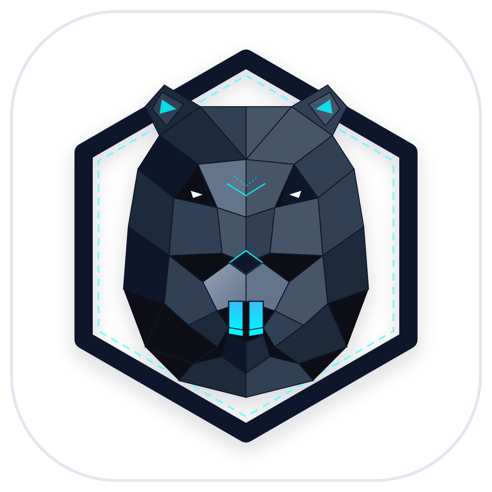
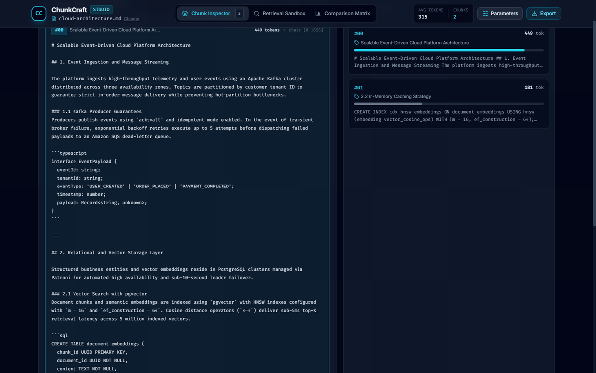
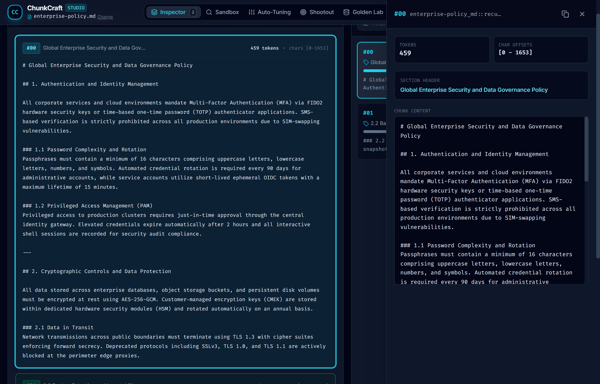
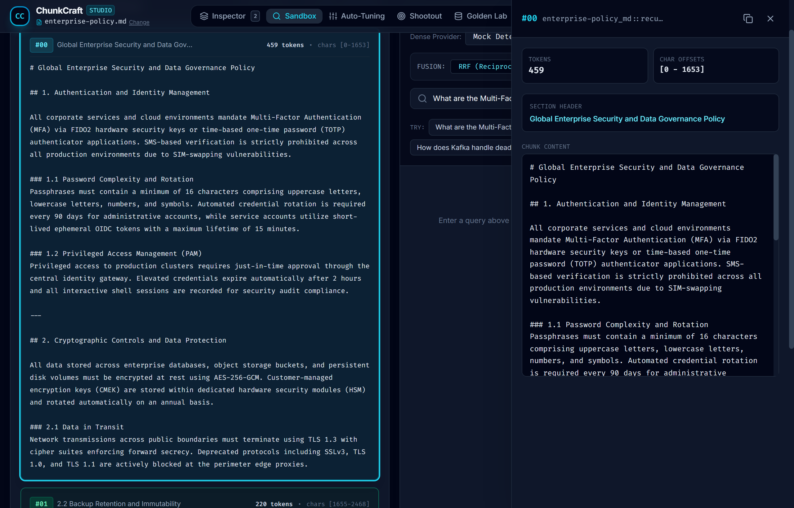
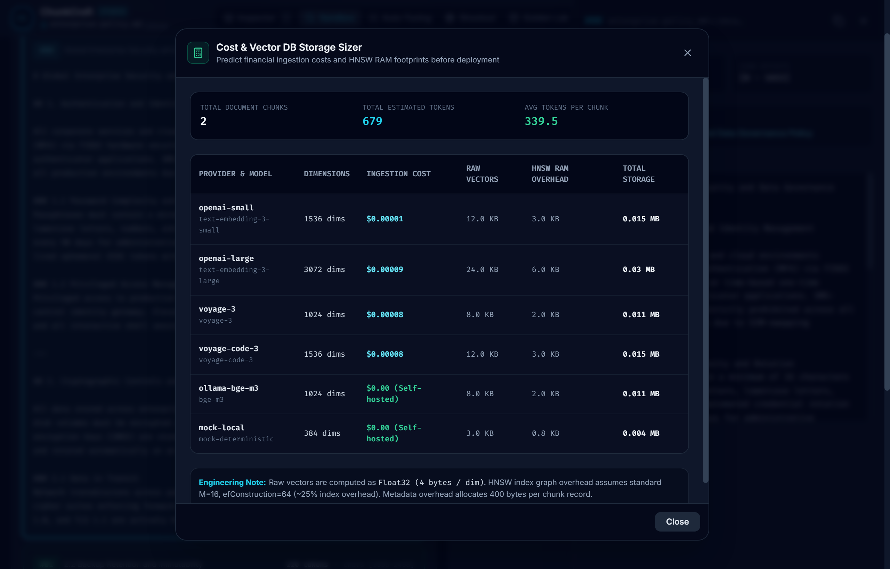
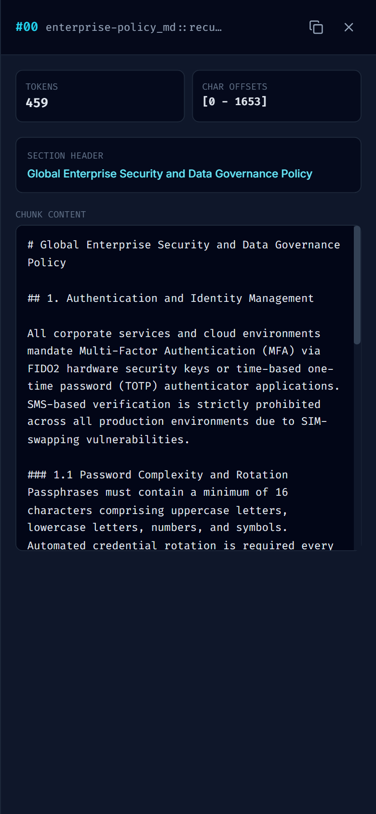

<p align="center">
  
</p>

<h1 align="center">ChunkCraft</h1>

<p align="center">
  <strong>Production RAG chunking benchmark, embedding evaluation suite, and React 19 visual retrieval studio</strong>
</p>

<p align="center">
  <a href="https://github.com/alexandrmotologa/chunkcraft/actions"></a>
  <a href="https://github.com/alexandrmotologa/chunkcraft/blob/main/LICENSE"></a>
  <a href="https://www.typescriptlang.org/"></a>
  <a href="https://react.dev/"></a>
  <a href="https://nodejs.org/"></a>
</p>

<p align="center">
  
</p>

---

## Overview

ChunkCraft is a developer toolkit and local Web Studio for testing document chunking strategies, benchmarking embedding models, and measuring vector retrieval accuracy before deploying Retrieval-Augmented Generation (RAG) pipelines to production.

Most RAG regressions originate during document ingestion:
* Arbitrary character splitting fractures code blocks, Markdown tables, and sentences.
* Embedding model choices are made without evaluating domain retrieval precision or query latency.
* Chunk size and overlap parameters are adjusted by intuition instead of measurable metrics like Precision@K, Recall@K, and Mean Reciprocal Rank (MRR).

ChunkCraft provides a command-line interface and an embedded React 19 Web Studio that visualizes chunks over raw documents and computes retrieval metrics against golden test queries.

---

## Visual Studio & UI Walkthrough

### 1. Document Stream & Chunk Inspector
Inspect chunks directly over the original document layout with distinct color-coded segment boundaries, token meters, character ranges, and overlap indicators.

<p align="center">
  
</p>

### 2. Interactive Retrieval Sandbox with Hybrid RRF Search
Test live queries across Dense Vector, Sparse Okapi BM25, and Hybrid Retrieval with configurable Reciprocal Rank Fusion (RRF) and linear alpha blending. Pin retrieved chunks directly as ground truth for golden query evaluation.

<p align="center">
  
</p>

### 3. Hyper-Parameter Auto-Tuning Panel
Run multi-dimensional grid search across candidate chunk sizes, overlaps, and chunking engines to identify Pareto-optimal configurations that maximize MRR while minimizing context fragmentation.

<p align="center">
  
</p>

### 4. Embedding Model Shootout
Compare dense models against sparse Okapi BM25 baselines on identical chunks, measuring indexing latency, query turnaround time, MRR, Recall@3, and estimated RAM footprint.

<p align="center">
  
</p>

### 5. Cost & Vector DB Storage Sizer
Forecast token ingestion API costs and vector database memory overhead (Float32 vectors plus HNSW index graph) across OpenAI, Voyage AI, and local Ollama deployments before scaling ingestion.

<p align="center">
  
</p>

### 6. Multi-Strategy Comparison Matrix
Compare multiple chunking strategies side by side on Precision@1, Precision@3, Precision@5, Recall@3, Recall@5, MRR, Hit Rate, and Context Fragmentation.

<p align="center">
  
</p>

### 7. Responsive Mobile & Tablet Experience
The studio interface adapts across viewport sizes with fluid touch-scrolling navigation, collapsible control drawers, and full document stream inspection on phone and tablet displays.

<p align="center">
  
</p>

---

## Key Capabilities

* **Multi-Strategy Chunking Pipeline:** Run documents through Recursive Character, Markdown AST Section-Aware, Semantic Sentence Boundary, Token Sliding Window, Hierarchical Parent-Child, Code-Aware AST, and JSON Key-Path chunkers.
* **Hybrid Retrieval & RRF Fusion:** Blends sparse lexical matching (BM25) and dense semantic vectors using Reciprocal Rank Fusion (RRF, k=60) or min-max normalized linear alpha blending.
* **Pareto Auto-Tuning:** Automated grid search explores combinations of chunk sizes and overlaps to identify the Pareto-optimal configuration maximizing MRR and non-fragmentation.
* **Embedding Model Shootout:** Run head-to-head comparisons across embedding models (BM25, Mock-384, Mock-768, OpenAI, Voyage AI, Ollama) on identical chunks.
* **Cost & Vector DB Storage Sizer:** Estimate ingestion API costs and vector database memory footprint (Float32 vectors plus HNSW index graph overhead) before ingesting millions of documents.
* **Golden Query Lab:** Manage evaluation query pairs and keyword ground-truth vectors, with automated synthesis from document headers and one-click JSON export.
* **Deterministic Offline Embeddings:** Built-in pseudo-random vector hashing and BM25 sparse retrieval allow full CI testing without external API keys or cloud spend.
* **React 19 Visual Studio:** Local interactive web application with real-time chunk highlighting, token meters, overlap visualization, live search sandbox, and side-by-side strategy diff matrix.

---

## Architecture

```
+-----------------------------------------------------------------------+
|                       ChunkCraft Architecture                         |
+-----------------------------------------------------------------------+

  [ CLI: npx chunkcraft ]                   [ Embedded React 19 Studio ]
            |                                           |
            +-------------------+   +-------------------+
                                |   |
                                v   v
+-----------------------------------------------------------------------+
|                     ChunkCraft Core Runtime Engine                    |
+-----------------------------------------------------------------------+
| Document Ingestion & Parsers                                          |
|   * Markdown & Code AST via remark/unist                              |
|   * Structural metadata extraction & header preservation              |
+-----------------------------------------------------------------------+
| Chunking Engines                                                      |
|   * Recursive Character (hierarchical delimiters)                     |
|   * Markdown AST (H1 > H2 > H3 contextual nesting)                    |
|   * Semantic Boundary (sentence boundary & punctuation heuristics)    |
|   * Token Sliding Window (exact token budget allocation)              |
|   * Hierarchical Parent-Child (linked macro/micro retrieval units)    |
|   * Code-Aware (TypeScript, Python, Go, Rust symbol boundaries)       |
|   * JSON Key-Path (RFC 8259 structural path tracking)                 |
+-----------------------------------------------------------------------+
| Vector Store, Embeddings & Retrieval                                  |
|   * In-Memory Vector Store with Cosine Similarity                     |
|   * Hybrid Retriever (Reciprocal Rank Fusion & Linear Blending)       |
|   * Mock Hash-Based Provider (zero-cost offline CI)                   |
|   * BM25 Sparse Vector Provider (lexical ranking baseline)            |
|   * OpenAI / Voyage AI / Ollama Adapters                              |
+-----------------------------------------------------------------------+
| Evaluation & Sizing Engines                                           |
|   * Retrieval Metrics: Precision@K, Recall@K, MRR, Hit Rate           |
|   * Pareto Auto-Tuner: Multi-parameter grid search optimizer          |
|   * Model Shootout: Multi-model accuracy and latency benchmark        |
|   * Cost & Sizing: API pricing and HNSW RAM overhead calculator       |
|   * Exporters: Terminal Table, Markdown, JSON, Standalone HTML       |
+-----------------------------------------------------------------------+
```

---

## Quickstart

### 1. Installation

```bash
# Clone and build locally
git clone https://github.com/alexandrmotologa/chunkcraft.git
cd chunkcraft
npm install
npm run build
```

### 2. Chunking Documents via CLI

```bash
# Run Recursive Character chunking
node bin/chunkcraft.js chunk examples/sample-docs/enterprise-policy.md --strategy recursive-char --chunk-size 500 --chunk-overlap 50

# Run Code-Aware chunking on TypeScript source files
node bin/chunkcraft.js chunk src/core/storage/vector-store.ts --strategy code-aware --chunk-size 300

# Run JSON Key-Path chunking
node bin/chunkcraft.js chunk examples/golden-queries.json --strategy json-keypath --chunk-size 250
```

### 3. Auto-Tuning Optimal Parameters

```bash
# Search for Pareto-optimal chunk size and overlap
node bin/chunkcraft.js tune examples/sample-docs/enterprise-policy.md \
  --sizes 200,400,600 \
  --overlaps 0,25,50 \
  --strategies recursive-char,markdown-ast,semantic-boundary
```

### 4. Running Embedding Model Shootout

```bash
# Compare BM25, Mock-384, and Mock-768 on identical chunks
node bin/chunkcraft.js shootout examples/sample-docs/enterprise-policy.md \
  --providers bm25,mock-384,mock-768
```

### 5. Estimating Storage & API Cost

```bash
# Calculate token costs and HNSW RAM sizing
node bin/chunkcraft.js sizer examples/sample-docs/enterprise-policy.md --chunk-size 400
```

### 6. Synthesizing Test Queries

```bash
# Generate realistic evaluation queries directly from document structure
node bin/chunkcraft.js generate-queries examples/sample-docs/cloud-architecture.md --count 5 --output test-queries.json
```

### 7. Launching the Embedded React 19 Studio

```bash
# Start the local server and open the Web Studio in browser
node bin/chunkcraft.js studio examples/sample-docs/enterprise-policy.md --port 50090
```

---

## Evaluation Metrics

| Metric | Formula / Definition | Target in Production RAG |
| :--- | :--- | :--- |
| **Precision@K** | Ratio of relevant chunks among the top-K retrieved results. | > 0.70 |
| **Recall@K** | Proportion of expected key context fragments retrieved within top-K. | > 0.85 |
| **MRR (Mean Reciprocal Rank)** | Average reciprocal rank `1 / rank` of the first relevant chunk found. | > 0.80 |
| **Hit Rate** | Proportion of test queries where at least one relevant chunk appears in top-K. | > 0.90 |
| **Fragmentation Score** | Frequency of split paragraphs, severed code blocks, or orphan tables. | < 0.10 |
| **Token Utilization** | Standard deviation of token counts relative to target budget. | Controlled variance |

---

## Supported Chunking Strategies

1. **`recursive-char` (Recursive Character):**
   Splits text recursively across delimiter hierarchy (`\n\n`, `\n`, `. `, ` `, `""`) and packs segments up to token budget with sliding overlap.

2. **`markdown-ast` (Markdown AST Section-Aware):**
   Constructs a syntax tree using `remark-parse`. Keeps headers, code fences, blockquotes, and tables intact as atomic nodes, tracking full breadcrumb hierarchies (`H1 > H2 > H3`).

3. **`semantic-boundary` (Semantic Boundary):**
   Segments by sentence propositions while protecting abbreviations (`e.g.`, `i.e.`, `Dr.`), URLs, and decimal numbers from splitting.

4. **`token-window` (Token Sliding Window):**
   Applies an exact BPE token window with configurable stride (`chunkSize - chunkOverlap`).

5. **`hierarchical` (Parent-Child):**
   Emits parent macro chunks (e.g. 1000 tokens) linked to child micro chunks (e.g. 250 tokens), allowing parent-document retrieval evaluation.

6. **`code-aware` (Code-Aware Symbol Boundaries):**
   Respects function, class, and interface boundaries in source code across TypeScript, JavaScript, Python, Go, and Rust.

7. **`json-keypath` (JSON Structural Key-Path):**
   Traverses JSON structures, prepending dot-notated key paths (e.g. `data.users[0].credentials`) to ensure semantic context is retained.

---

## Supported Embedding Providers

* **`mock` (Deterministic Pseudo-Vectors):**
  Uses random projection across token n-grams. Identical inputs yield identical vectors; shared keywords yield high cosine similarity. Runs offline in sub-millisecond time.
* **`bm25` (Okapi BM25 Sparse):**
  In-memory lexical ranking engine for testing traditional keyword search against dense vector retrieval.
* **`openai` (OpenAI REST Client):**
  Supports `text-embedding-3-small`, `text-embedding-3-large`, and custom models via `OPENAI_API_KEY`.
* **`voyage` (Voyage AI REST Client):**
  Supports `voyage-3` and `voyage-code-3` via `VOYAGE_API_KEY`.
* **`ollama` (Local Ollama Instance):**
  Queries local open-weights embedding models (`bge-m3`, `nomic-embed-text`) via `http://localhost:11434`.

---

## Project Structure

```
chunkcraft/
├── bin/
│   └── chunkcraft.js               # CLI executable entry point
├── src/
│   ├── cli/
│   │   ├── commands/               # CLI commands (chunk, benchmark, tune, shootout, sizer, studio)
│   │   └── index.ts                # Commander program definition
│   ├── core/
│   │   ├── chunkers/               # Strategy implementations
│   │   │   ├── base.ts
│   │   │   ├── recursive-char.ts
│   │   │   ├── markdown-ast.ts
│   │   │   ├── semantic-boundary.ts
│   │   │   ├── token-window.ts
│   │   │   ├── hierarchical.ts
│   │   │   ├── code-aware.ts
│   │   │   └── json-keypath.ts
│   │   ├── embeddings/             # Embedding adapters (Mock, BM25, OpenAI, Voyage, Ollama)
│   │   ├── evaluation/             # Metrics, auto-tuner, model shootout, test runner
│   │   ├── retrieval/              # Hybrid retrieval (RRF and linear score blending)
│   │   ├── storage/                # Vector store, cost & sizing calculator, vector math
│   │   └── tokenizer/              # Token counter and BPE estimator
│   ├── server/                     # Local Node HTTP REST API server
│   └── studio/                     # React 19 + Vite + Tailwind CSS Web Studio
├── tests/                          # Vitest unit and integration test suite
├── examples/                       # Sample documents and golden queries
├── docs/                           # Documentation and visual assets
├── package.json
└── tsconfig.json
```

---

## License

MIT (c) 2026 Alexandr Motologa
